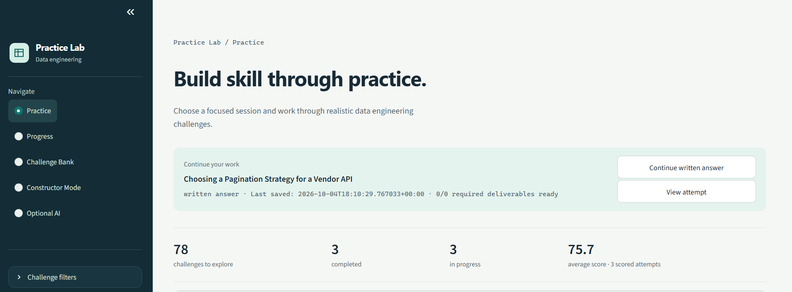

# Data Engineering Practice Lab

[Explore the modes](#how-its-structured) · [Run it locally](#how-to-run) · [Contribute](CONTRIBUTING.md)

From someone who is in love with data to you, someone who is in love with data.



## What it is

This project is built to be the ultimate, or at least a super helpful, platform for everyone looking to become a Data Engineer. It gives you an expandable exercise bank, interactive engineering tools, and a way to track your progress. It also gives you tools to use when planning and building your own projects.

- **Practice at your own pace.** Filter exercises by topic, difficulty, and available time; use hints when you need them.
- **Make working artifacts.** Write SQL and Python, draw data models, generate related datasets, and plan pipelines.
- **Keep your work.** Answers and progress live in a local SQLite database, with exports for backup and sharing.

## The Philosophy

Education should be accessible, centralized, customized, and free. In this project, we put that into practice by following these guidelines:

- **Customizable exercises**: The platform comes with a set of default exercises covering the tools and modalities it has to offer. But you can also add your own exercises in any supported format through a prompt that you can paste into your favorite LLM. (This is very important: education should NEVER be tied to a single company. If you want to use ChatGPT, use it. If you want to use Claude, use it. If you want to use DeepSeek, use it, and so on.)

- **Optional AI**: The platform offers the option of connecting your favorite LLM through a compatible API, with an API key if your provider requires one. With it enabled, you can generate exercises, repair drafts that fail validation, get evaluation suggestions for your answers, and customize mock-data recipes. Obviously, this is 100% optional.

- **Learn by doing**: Plato said "Wisdom means nothing if it is not put into action" and I really believe that. Here, you'll have tools to use in your personal projects, all the way from documentation and planning (diagrams) to writing and reviewing SQL (SQL Playground). Personally, all the diagrams in my GitHub repos were made here.

## How the idea was born

This idea was born after I got my **Data Engineer certification from DataCamp**. After completing it, I needed somewhere to keep practicing things like data modeling, data warehousing concepts, etc

## How it was built

This platform was built using a combination of AI models and agent harnesses. The initial groundwork was developed using Codex as the harness, primarily powered by GPT-5.6 Terra, which was the best option available to me at the time.

A few weeks later, when I decided to revisit the project, I switched to Pi as my primary harness and adopted a multi-model workflow: GPT-6 Astra as the lead agent, GPT-6.1 Sol as the builder, and Claude Opus 5.5 handling UI/UX.

This approach has not only accelerated development but also given me hands-on experience with harness engineering, context engineering, and agent orchestration. It has also taught me how to coordinate multiple AI models within a single development workflow.

## How it's structured

The sidebar has five areas. Choose **Practice** for a guided challenge or **Constructor Mode** for an open workspace.

| Area | What you'll find |
| --- | --- |
| **Practice** | Written exercises, modeling tasks, SQL and Python labs, investigations, repairs, integrated case studies, and connected capstones. |
| **Constructor Mode** | Conceptual ERD, logical ERD, and star-schema Diagram Maker; SQL Playground & Formatter; an Excalidraw-based Pipeline Designer; and Mock Data Generator. |
| **Progress** | Attempt history, recorded scores, weak-topic review, recommendations, and progress backup/restore. |
| **Challenge Bank** | Browse exercises, create exercise prompts, validate imported packages, and expand your collection. |
| **Optional AI** | Configure an optional session connection for evaluation suggestions, exercise creation and repair, or mock-data customization. |

### Practice mode

Choose the kind of session you want:

| Route | What you do |
| --- | --- |
| **Daily Scenario** | Work through a focused, realistic engineering decision. |
| **Complete Case Study** | Solve a broader case with several related requirements. |
| **Review Weak Area** | Revisit topics identified by your recorded evaluations. |
| **Surprise Me** | Get a challenge from your current selection. |
| **SQL Practice** | Query supplied datasets in DuckDB, inspect results and query plans, and check your answers. |
| **Data-quality Detective** | Investigate defects using source profiles and SQL, document evidence, and verify corrected outputs. |
| **Python Practice** | Write and check Python functions, with correctness checks and optional time and memory targets. |
| **Connected Capstone** | Build one business system through linked stages, carrying your work into the next step. |

The routes draw from different exercise formats. Alongside written answers, you'll find **conceptual and logical modeling, star schemas, pipeline design, mock-data tasks, SQL analysis, repair exercises, and integrated case studies**. Repair exercises begin with an artifact that needs fixing; integrated cases combine several tools and deliverables in one attempt. Use Challenge Bank and the practice filters to explore these formats.

You can preview a brief before starting, reveal hints progressively, save drafts, and reopen unfinished attempts. Completion and evaluation are explicit actions. Executable SQL and Python exercises have local checks; written and design work can be reviewed manually or with an optional AI suggestion before you save an evaluation.

**Try the connected project:** the bundled *Subscription Coffee Roastery* connects a business model, an operational model, generated data, an analytical model, SQL queries, and an operations/pipeline design. Your saved dataset becomes the input for the SQL stage. Review downstream handoffs when an earlier design changes.

<!-- SCREENSHOT PLACEHOLDER: Add assets/screenshots/connected-capstone.png here.
     Show the coffee-roastery stage overview with a few stages completed. -->

### Constructor Mode

Open a tool without starting an exercise. These workspaces are also used by practice tasks that require engineering artifacts.

| Tool | What you can build |
| --- | --- |
| **Diagram Maker** | Conceptual ERDs, logical ERDs, and star schemas. Add entities, fields, keys, relationships, and freehand notes; import tables from CREATE TABLE SQL; export editable JSON or a PNG. |
| **SQL Playground & Formatter** | Format SQL and Jinja, convert between eight SQL dialects, visualize query structure, and inspect pasted PostgreSQL EXPLAIN plans. This is an analysis workspace; it does not execute SQL. Use SQL Practice for executable exercises. |
| **Pipeline Designer** | Plan pipelines on an **Excalidraw-based canvas**. Combine sources, transformations, storage, and destinations; record engineering decisions; review design findings; export a build specification, project JSON, Excalidraw drawing, PNG, or SVG. It plans pipelines rather than running them. |
| **Mock Data Generator** | Define related tables, choose generators and column rules, preserve foreign-key relationships, and preview realistic values. Generate repeatable datasets and download CSV, JSON, JSON Lines, Parquet, or delimited text. |

Diagrams, pipeline projects, and mock recipes save locally. SQL scratch work and generated download files are temporary, so export anything you want to keep.

<!-- SCREENSHOT PLACEHOLDER: Add assets/screenshots/constructor-tools.png here.
     Prefer a readable montage: one relational diagram and one pipeline canvas. -->

### Progress

See completed and unfinished attempts, recorded scores, activity history, and topics to revisit. Reopen saved work or follow a recommended challenge. Scores come from evaluations you explicitly save, so the dashboard reflects your own review history.

Progress backups include attempts, linked deliverables, and connected projects. **Standalone Constructor diagrams, pipeline projects, and mock recipes need their own JSON exports; keep a separate copy of your challenge bank too.**

<!-- SCREENSHOT PLACEHOLDER: Add assets/screenshots/progress.png here.
     Show sample activity and topic feedback, without private notes or answers. -->

### Challenge Bank

Browse the installed exercises or make the bank your own:

1. Open **Build an exercise prompt** and choose a format, topic, difficulty, and other requirements.
2. Copy the prompt to your preferred assistant, or use the optional connected AI to create a draft.
3. Bring the JSON response back through **Upload JSON** or **Paste JSON**.
4. Select **Validate and review**, inspect the student preview, then **Append exercises**.

Supported creation formats include written practice, diagrams, SQL Practice, Data-quality Detective, Python Practice, pipeline design, mock data, SQL analysis, repairs, integrated case studies, and Connected Capstone. Imports are reviewed before they enter the bank; executable Python packages also require local runner validation.

### Optional AI

AI is off by default. You can use portable prompts without connecting an API, or configure a **Chat Completions-compatible** or **Anthropic Messages** endpoint for the current session. Local compatible servers are supported too.

Review the prompt before sending it. Responses remain suggestions or drafts: you decide whether to save an evaluation or append an exercise. API keys stay in session memory and are excluded from progress backups. Provider access and any usage charges depend on the connection you choose.

## How to run

Download the repository ZIP and extract it, or clone it:

```sh
git clone https://github.com/rojzzzzz/Data-Engineering-Practice-Lab.git
cd Data-Engineering-Practice-Lab
```

Choose **Docker** for a containerized installation, or **Python** for a lightweight local setup. Both open the same app. The first installation needs internet to download dependencies; normal use does not require Node.js.

### Option 1: Docker

Install Docker with Docker Compose available. On Windows or macOS, start Docker Desktop; on Windows, use Linux containers. From the project folder, run:

```sh
docker compose up -d --build
```

Open **[localhost:8501](http://localhost:8501/)** in your browser.

The app's progress and challenge bank are stored in persistent Docker volumes. They survive rebuilds and a normal shutdown:

```sh
docker compose down
```

To update the running app after changing its files, run `docker compose up -d --build` again and refresh your browser. For startup problems, check `docker compose logs -f practice-lab`. Avoid `docker compose down --volumes` unless you intend to delete the saved Docker data.

### Option 2: Python

Use **Python 3.11 or newer**. Open a terminal in the project folder.

**Windows — PowerShell**

```powershell
py -3 -m venv .venv
.\.venv\Scripts\python.exe -m pip install -r requirements.txt
.\.venv\Scripts\python.exe -m streamlit run app.py
```

These commands use the environment directly, so PowerShell activation is unnecessary.

**macOS / Linux**

```sh
python3 -m venv .venv
.venv/bin/python -m pip install -r requirements.txt
.venv/bin/python -m streamlit run app.py
```

Open **[localhost:8501](http://localhost:8501/)**. Keep the terminal running while you use the app; press **Ctrl+C** to stop it. The local installation stores progress in `database/practice.db` and the active challenge bank in `data/challenges.json`.

### Optional: enable Python exercise execution

You can explore the app without this step. To run and check Python exercises, enable the local Docker execution service. Keep Docker running in Linux-container mode.

<details>
<summary><strong>If you run the app with Docker Compose</strong></summary>

The one-time setup script also requires Python 3.11+ on your host. From the project folder:

```sh
python scripts/setup_python_runner.py
docker compose -f compose.yaml -f compose.python.yaml up -d --build
```

On Windows, use `py -3` instead of `python` for the setup command if needed; on macOS/Linux, use `python3`.

Setup builds the execution image and creates local runner credentials in `.python-runner`. The Compose override connects the app to its private runner service. Use the same two `-f` options when updating or stopping this configuration:

```sh
docker compose -f compose.yaml -f compose.python.yaml down
```

</details>

<details>
<summary><strong>If you run Streamlit directly with Python</strong></summary>

From the project folder, run the setup and controller in one terminal.

**Windows — PowerShell**

```powershell
.\.venv\Scripts\python.exe scripts/setup_python_runner.py
.\.venv\Scripts\python.exe -m runner.controller
```

**macOS / Linux**

```sh
.venv/bin/python scripts/setup_python_runner.py
.venv/bin/python -m runner.controller
```

Leave that terminal open, then start Streamlit in a second terminal using the command from your Python installation above. Use one controller per Docker engine; stop a native controller before switching to the Compose runner.

</details>

The runner controls Docker execution. Keep its controller private and never commit `.python-runner` credentials. See [SECURITY.md](SECURITY.md) for the local-use boundary.

### Your first session

1. Open **Practice → Daily Scenario**, preview a brief, and select **Start challenge**.
2. Write an answer, leave the text field to save it, and use a hint if you get stuck.
3. Mark the work complete when ready. Review it yourself or export the evaluation prompt to your chosen assistant, then explicitly save your evaluation.
4. Visit **Progress** to see your recorded result, or try **Constructor Mode → Diagram Maker** to build freely.

The app is intended for **local, single-user use**. Keep saved work and credentials private; a public deployment needs additional access controls.

## Contributing and license

Found a confusing exercise or have an idea for a tool? Contributions and reproducible bug reports are welcome. See [CONTRIBUTING.md](CONTRIBUTING.md) for development setup and checks, and [SECURITY.md](SECURITY.md) for vulnerability reporting.

Released under the [MIT License](LICENSE). Bundled libraries and fonts retain their own licenses; keep the third-party notices in `erd_frontend` and `static/pipeline` when redistributing the app.
